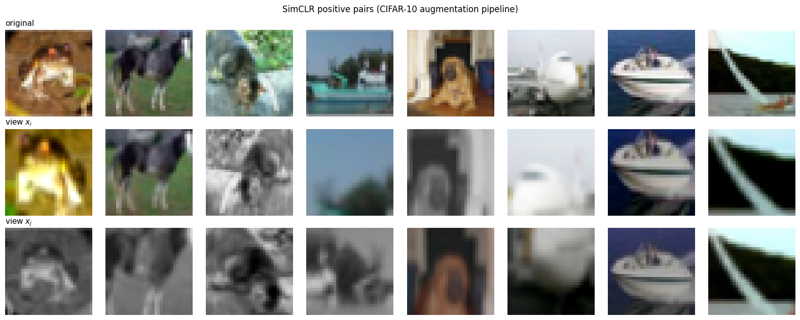
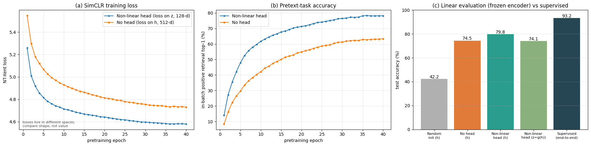
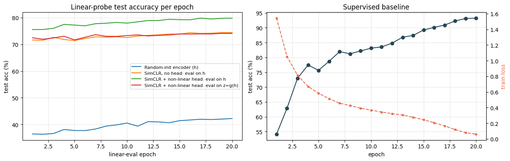

# SimCLR on CIFAR-10 — Projection-Head Ablation

[](https://colab.research.google.com/github/YOUR_USERNAME/YOUR_REPO_NAME/blob/main/notebooks/SimCLR_CIFAR10_Colab.ipynb)

> Replace `YOUR_USERNAME` and `YOUR_REPO_NAME` in the badge URL (and in the clone commands below) once the repository exists.

A small-scale reproduction of **SimCLR** (Chen et al., 2020) on CIFAR-10, studying how much the **non-linear projection head** contributes to the quality of the learned representation. The whole project is a single, self-contained, runnable Google Colab notebook.

## Table of contents
1. [Overview](#overview)
2. [Experiments](#experiments)
3. [Methodology](#methodology)
4. [Scale adaptation vs. the paper](#scale-adaptation-vs-the-paper)
5. [Repository structure](#repository-structure)
6. [Technologies](#technologies)
7. [Dataset](#dataset)
8. [Running in Google Colab](#running-in-google-colab)
9. [Running locally](#running-locally)
10. [Configuration](#configuration)
11. [Results](#results)
12. [Limitations](#limitations)
13. [Future improvements](#future-improvements)
14. [Troubleshooting](#troubleshooting)
15. [References](#references)
16. [License](#license)

## Overview
SimCLR learns image representations without labels by pulling together two augmented views of the same image and pushing apart views of different images (NT-Xent contrastive loss). A key design choice in the paper is a small MLP **projection head** `g(·)` placed after the encoder `f(·)`: the loss is computed on `z = g(h)`, but the representation used for downstream tasks is `h = f(x)`.

This repository tests that design choice at a compute budget that fits a free Colab GPU: ResNet-18, CIFAR-10, batch size 256, 40 pretraining epochs.

**Objective:** compare linear-evaluation accuracy of encoders pretrained **with** vs. **without** the projection head, alongside a random-encoder lower bound and a supervised upper-bound baseline.

## Experiments
| # | Experiment | What is trained | Evaluated with |
|---|---|---|---|
| 1 | SimCLR + non-linear projection head | Encoder + MLP head, NT-Xent on `z` (128-d) | Linear probe on `h` (512-d), and also on `z = g(h)` |
| 2 | SimCLR **without** projection head | Encoder only, NT-Xent applied directly on `h` (512-d) | Linear probe on `h` |
| 3 | Supervised ResNet-18 | Encoder + `Linear(512, 10)`, end-to-end with labels | Test accuracy |
| 4 | Random-init encoder (extra) | Nothing (frozen random weights) | Linear probe on `h` |

Experiments 1 and 2 use identical code, seed, optimiser, and schedule; the **only** difference is the `use_head` flag.

## Methodology
```
CIFAR-10 train (no labels) ──► two random augmentations (x_i, x_j)
        │
        ▼
 ResNet-18 encoder f  ──► h (512-d) ──► projection head g ──► z (128-d)
                                                            │
                                         NT-Xent loss (τ = 0.5, 2N = 512 views / step)
        │
        ▼  (after pretraining: freeze f, discard g)
 extract h once for train/test ──► standardise with train stats ──► nn.Linear(512, 10) ──► test accuracy
```
Key implementation details (all taken from the notebook):
- **Encoder:** `torchvision` ResNet-18 with a CIFAR stem (3×3 stride-1 conv, max-pool removed), `fc` replaced by `Identity`.
- **Projection head:** `Linear(512,512) → BatchNorm1d → ReLU → Linear(512,128)`; replaced by `Identity` in the ablation.
- **Loss:** vectorised NT-Xent (fp32), unit-tested in the notebook against a naive loop implementation of the paper's equation.
- **Augmentations:** RandomResizedCrop(scale 0.2–1), horizontal flip, colour jitter (0.4, 0.4, 0.4, 0.1; p = 0.8), grayscale (p = 0.2). No blur.
- **Pretraining:** Adam, lr 1e-3, weight decay 1e-6, cosine decay, fp16 autocast, seed 42.
- **Linear evaluation:** frozen encoder, pre-extracted features (no augmentation), single linear layer, 20 epochs, **final-epoch** test accuracy reported (no checkpoint selection on the test set).
- **Supervised baseline:** SGD + Nesterov, OneCycle LR (max 0.1), random crop + flip, 20 epochs.

More detail: [`docs/methodology.md`](docs/methodology.md).



## Scale adaptation vs. the paper
| Aspect | Paper (main results) | This notebook |
|---|---|---|
| Dataset | ImageNet, 224×224 | CIFAR-10, 32×32 |
| Backbone | ResNet-50 (h ∈ ℝ²⁰⁴⁸) | ResNet-18, CIFAR stem (h ∈ ℝ⁵¹²) |
| Batch size | 4096 | 256 |
| Pretraining epochs | 100–1000 | 40 |
| Optimiser | LARS | Adam |
| Temperature | tuned | 0.5 |
| Linear eval | 90 epochs, with augmentation | 20 epochs on frozen pre-extracted features |

Absolute accuracies are therefore **not comparable** to the paper's.

## Repository structure
```
.
├── README.md                    # this file
├── requirements.txt             # third-party dependencies (unpinned; see notes inside)
├── .gitignore                   # excludes datasets, checkpoints, secrets, caches
├── notebooks/
│   └── SimCLR_CIFAR10_Colab.ipynb   # the original, unmodified, runnable notebook (with saved outputs)
├── docs/
│   ├── methodology.md           # detailed description of the pipeline
│   ├── data_and_outputs.md      # what is read/written and where
│   └── images/                  # figures extracted from the notebook's saved outputs
├── data/
│   └── README.md                # dataset instructions (data files are git-ignored)
└── outputs/
    └── .gitkeep                 # local scratch folder for checkpoints/plots (git-ignored)
```
The project is deliberately **notebook-only**: the code is a linear, one-shot experiment, and splitting it into `src/` modules would duplicate it without making it easier to run. No `LICENSE` file is included yet — see [License](#license).

## Technologies
Python 3, PyTorch, torchvision, NumPy, pandas, Matplotlib. See [`requirements.txt`](requirements.txt). Mixed precision uses `torch.autocast` / `torch.amp.GradScaler`.

## Dataset
CIFAR-10 is downloaded automatically by `torchvision` on first run — no manual steps. Details in [`data/README.md`](data/README.md).

## Running in Google Colab
1. Click the **Open in Colab** badge at the top (after you have set your username/repo in the URL).
2. **Runtime → Change runtime type → GPU** (the original run used a Tesla T4).
3. **Runtime → Run all.** No installation cell is needed: Colab already provides PyTorch, torchvision, NumPy, pandas and Matplotlib.

Approximate cost, read from the timings printed in the notebook's saved run on a T4: ~77 min for each SimCLR pretraining run (two runs) and ~11 min for the supervised baseline, i.e. roughly 3 hours in total plus feature extraction and linear probing. Free-tier session limits may interrupt a run this long; set `QUICK_MODE = True` first to smoke-test (2 epochs everywhere; the notebook's comment estimates ~5 min).

## Running locally
Supported in principle (the notebook falls back to CPU, but full training on CPU would be impractically slow); **not verified** by the repository author.
```bash
git clone https://github.com/YOUR_USERNAME/YOUR_REPO_NAME.git
cd YOUR_REPO_NAME
python -m venv .venv && source .venv/bin/activate       # Windows: .venv\Scripts\activate
# 1) install the PyTorch build for your hardware: https://pytorch.org/get-started/locally/
# 2) then the rest:
pip install -r requirements.txt
jupyter notebook notebooks/SimCLR_CIFAR10_Colab.ipynb   # run from the repo root so ./data resolves to data/
```

## Configuration
All settings live in the `CFG` class in the notebook's setup cell:

| Parameter | Value | Meaning |
|---|---|---|
| `QUICK_MODE` | `False` | `True` → 2 epochs for all stages (smoke test) |
| `seed` | 42 | Random seed |
| `batch_size` | 256 | N (2N = 512 views per step) |
| `pretrain_epochs` | 40 | SimCLR pretraining epochs |
| `linear_epochs` | 20 | Linear-probe epochs |
| `sup_epochs` | 20 | Supervised baseline epochs |
| `tau` | 0.5 | NT-Xent temperature |
| `proj_dim` | 128 | Projection-head output size |
| `lr`, `weight_decay` | 1e-3, 1e-6 | Adam settings |
| `num_workers` | 0 | Set to 0 to avoid a DataLoader worker crash seen in Colab |
| `data_root` | `./data` | CIFAR-10 location |
| `use_amp` | `True` | fp16 autocast (auto-disabled without a GPU) |

## Results
Everything below is copied from the notebook's **saved outputs** from a single run (seed 42, Tesla T4, `torch 2.11.0+cu130`, `torchvision 0.26.0+cu130`). I did not re-run the notebook while preparing this repository.

| Method / representation | Feature dim | Training epochs | Test accuracy (%) |
|---|---:|---:|---:|
| Random-init encoder (`h`) | 512 | 0 | 42.21 |
| SimCLR, no head: eval on `h` | 512 | 40 | 74.46 |
| SimCLR + non-linear head: eval on `z = g(h)` | 128 | 40 | 74.10 |
| SimCLR + non-linear head: eval on `h` | 512 | 40 | 79.83 |
| Supervised ResNet-18 (end-to-end) | 512 | 20 | 93.22 |

Observed effects in this run:
- Projection head vs. none (`h` with head − `h` without head): **+5.37 points**.
- Pre- vs. post-head within Experiment 1 (`h` − `z`): **+5.73 points**.
- Final in-batch contrastive top-1 (pretext task): 78.2 % with head vs. 63.4 % without.




**Interpretation caveat:** these are single-run numbers with no repeated seeds or confidence intervals, so small differences should not be over-interpreted. The direction of the head/no-head difference matches what the paper reports qualitatively; the magnitude cannot be compared because the setup differs substantially (see the table above).

## Limitations
- One seed, one run per configuration; no variance estimates.
- Short pretraining (40 epochs) and small batch (256, i.e. few negatives) compared with the paper.
- Adam instead of LARS; no Gaussian blur; linear probe on non-augmented, pre-extracted features.
- The supervised baseline gets 20 epochs of a different optimiser/schedule, so it is a reference point, not a controlled comparison.
- Linear probe hyperparameters were not tuned.

## Future improvements
Ideas, not implemented: multiple seeds with confidence intervals; longer pretraining; sweeping temperature / batch size; a linear-head variant (the paper also compares to a linear projection); a `kNN` evaluation; moving the code into a Python package with a CLI.

## Troubleshooting
| Problem | Suggestion |
|---|---|
| "no GPU detected" warning | Colab: *Runtime → Change runtime type → GPU*. Or use `QUICK_MODE = True`. |
| `DataLoader worker exited unexpectedly` | Keep `num_workers = 0` (the default here). |
| Colab disconnects mid-run | Re-run; consider saving checkpoints to Drive (see [`docs/data_and_outputs.md`](docs/data_and_outputs.md)). Checkpoints are only written after each full pretraining run. |
| CUDA out of memory | Reduce `batch_size`; note this changes the number of negatives and therefore the results. |
| CIFAR-10 download fails | Check connectivity, or download manually from the [official page](https://www.cs.toronto.edu/~kriz/cifar.html) into `data/`. |

## References
- T. Chen, S. Kornblith, M. Norouzi, G. Hinton. *A Simple Framework for Contrastive Learning of Visual Representations.* ICML 2020. arXiv:2002.05709.
- A. Krizhevsky. *Learning Multiple Layers of Features from Tiny Images.* 2009 (CIFAR-10).

## License
**No license has been chosen yet.** Without a license file, others have no explicit permission to reuse the code. Pick one (e.g. MIT, Apache-2.0) at https://choosealicense.com and add a `LICENSE` file; then update this section.
